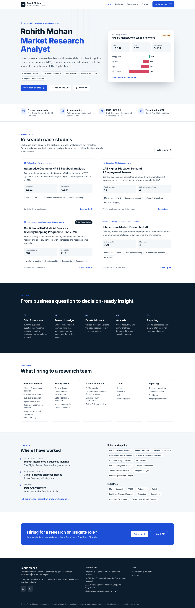
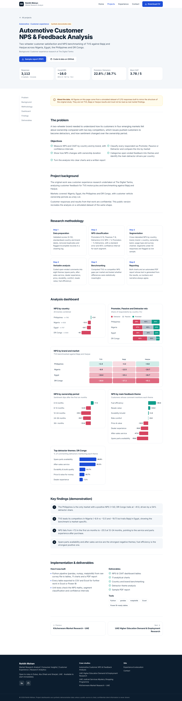
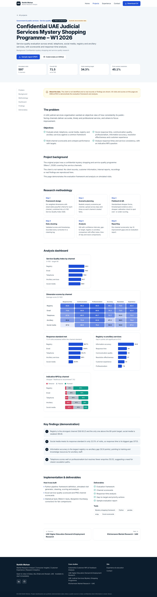
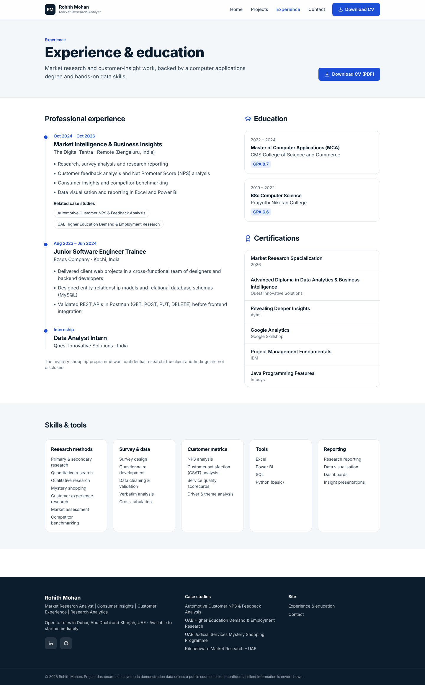
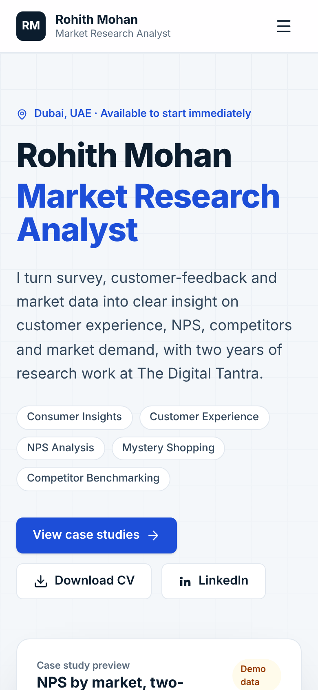

# Rohith Mohan – Market Research Analyst Portfolio

Portfolio website for **Rohith Mohan, Market Research Analyst** (consumer insights, customer experience, NPS and research analytics), targeting roles in Dubai, Abu Dhabi and Sharjah.

**Live site:** https://rohithmohan123.github.io/rohith-mohan-market-research-portfolio/



## Overview

A fast, static, recruiter-friendly website that shows who I am in the first screen, then backs it up with four detailed research case studies. Each case study explains the problem, background, methodology, analysis, findings, implementation and deliverables, and includes a dashboard, a downloadable sample report and a link to the code and data.

| Case study | Background | Data on the page |
|---|---|---|
| [Automotive Customer NPS & Feedback Analysis](https://rohithmohan123.github.io/rohith-mohan-market-research-portfolio/projects/automotive-nps-feedback-analysis/) | Customer experience research at The Digital Tantra (TVS vs Bajaj and Haojue; Nigeria, Egypt, Philippines, DR Congo) | Synthetic |
| [UAE Higher Education Demand & Employment Research](https://rohithmohan123.github.io/rohith-mohan-market-research-portfolio/projects/uae-higher-education-demand-employment/) | Market research at The Digital Tantra (BSc Library & Information Science; BSc Cognitive Science & AI) | Verified public sources + synthetic survey |
| [Confidential UAE Judicial Services Mystery Shopping – W1 2026](https://rohithmohan123.github.io/rohith-mohan-market-research-portfolio/projects/uae-judicial-services-mystery-shopping/) | Confidential mystery shopping programme; client not disclosed | Synthetic |
| [Kitchenware Market Research – UAE](https://rohithmohan123.github.io/rohith-mohan-market-research-portfolio/projects/kitchenware-market-research-uae/) | UAE kitchenware market research (e-commerce, organised retail, showrooms) | Synthetic, anonymised channels |

## Data honesty

- Project **backgrounds** describe real work. **No confidential client data, records, reports or findings are shown.**
- Dashboards use **synthetic demonstration data**, clearly labelled on every page, except the UAE study's "verified facts" and competitor table, which link to public sources.
- The mystery shopping client is not named anywhere.
- Kitchenware channels and brands are anonymised (Marketplace A/B, Hypermarket chain, Specialist showroom, Brand A–F) so simulated prices cannot be mistaken for real retailer prices.
- No statistics about me are invented: the "at a glance" strip only states facts (dates, degree, GPA).

## Objectives

- Make the professional identity clear within 10 seconds (name, role, location, CV button above the fold).
- Show research thinking, not just tools: problem → method → analysis → deliverables.
- Keep it fast, accessible and mobile-friendly, and easy to update from a single data file.

## Technology

- [Next.js 16](https://nextjs.org/) (App Router) with **static export**
- TypeScript, React 19
- Tailwind CSS 4
- Lucide icons
- Charts are lightweight React components (bars, diverging bars, 100% stacked bars, heatmaps, tables), with no chart library
- Playwright (Chrome) for the end-to-end test, CV and report PDF generation

## Folder structure

```
├── src/
│   ├── app/
│   │   ├── page.tsx                  # Home
│   │   ├── projects/page.tsx         # Project gallery
│   │   ├── projects/[slug]/page.tsx  # Case-study template (one page per project)
│   │   ├── experience/page.tsx       # Timeline, education, certifications, skills
│   │   ├── contact/page.tsx          # Contact details + form
│   │   ├── layout.tsx                # SEO metadata, header, footer
│   │   ├── sitemap.ts, robots.ts
│   │   └── globals.css               # Design tokens (Tailwind @theme)
│   ├── components/                   # Header, Footer, ProjectCard, Charts, ContactForm, icons
│   ├── data/projects.ts              # All case-study content and dashboard data
│   ├── data/kitchenware.json         # Generated summary of the simulated kitchenware audit
│   └── lib/site.ts                   # Personal details, experience, education, skills
├── public/
│   ├── cv/                           # Generated CV (PDF)
│   ├── reports/                      # Sample research reports (PDF)
│   └── data/                         # Simulated kitchenware dataset (CSV)
├── scripts/
│   ├── generate-kitchenware-data.mjs # Seeded synthetic data generator
│   └── build-pdfs.mjs                # Builds the CV and kitchenware report PDFs
├── tests/e2e.mjs                     # Browser test of the built site
└── docs/screenshots/
```

## Install and run

Requires Node.js 20.9+ (22 recommended).

```bash
git clone https://github.com/Rohithmohan123/rohith-mohan-market-research-portfolio.git
cd rohith-mohan-market-research-portfolio
npm install
npm run dev          # http://localhost:3000
```

Update personal details in `src/lib/site.ts` and case studies in `src/data/projects.ts`.

```bash
npm run data:kitchenware   # regenerate the simulated kitchenware dataset
npm run pdfs               # rebuild the CV and kitchenware report PDFs (needs Chrome)
```

## Build and test

```bash
npm run build              # static site in out/
npm test                   # browser checks against out/ (needs Chrome; set CHROME_PATH if needed)
E2E_OFFLINE=1 npm test     # same, without loading web fonts
```

The test checks every page (one `h1`, unique titles), every internal link and download, that each case study has the data notice, methodology, dashboard and findings, that the confidential page never names the client, contact-form validation, no horizontal scrolling at 390 px, the mobile menu, and no console errors. Current result: **9/9 passing**.

## Deployment

### GitHub Pages (used for the live site)

```bash
NEXT_PUBLIC_BASE_PATH=/rohith-mohan-market-research-portfolio npm run build
```

The repository's GitHub Actions workflow (`.github/workflows/deploy.yml`) runs this on every push to `main` and publishes `out/` to GitHub Pages. In the repository settings, set **Pages → Source** to **GitHub Actions**.

### Vercel or Netlify

Import the repository and use the default Next.js settings (build command `npm run build`, output directory `out`). Leave `NEXT_PUBLIC_BASE_PATH` unset when the site is served from the domain root.

## Screenshots

| | |
|---|---|
|  NPS case study |  Mystery shopping case study |
|  Experience and education |  Mobile |

## Limitations

- Static site: the contact form opens the visitor's email app (or copies the message for LinkedIn) rather than sending mail through a server.
- Dashboards are illustrative and use synthetic data, so they show methods and presentation, not real market results.
- Web fonts load from Google Fonts; the site falls back to system fonts if they are blocked.

## Licence

Code: MIT, see [LICENSE](LICENSE). Sample reports and synthetic datasets may be reused with attribution. The external sources cited in the UAE case study belong to their publishers.
